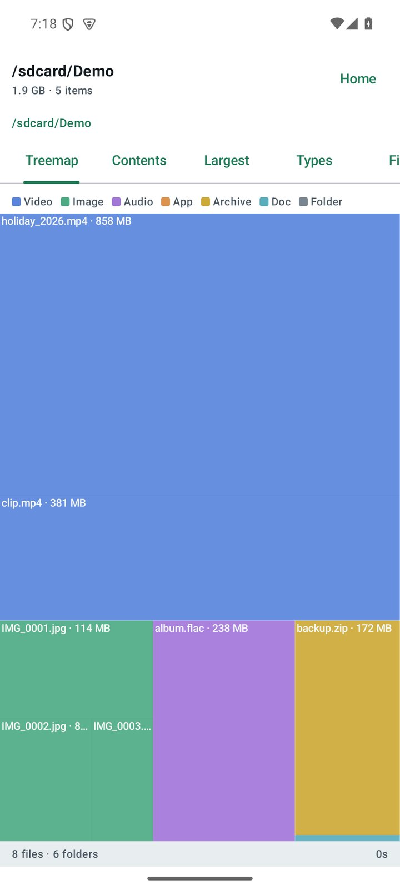

# DiskQuilt

[](https://github.com/Handy-Wibowo/DiskQuilt/actions/workflows/ci.yml)
[](LICENSE)
[-green.svg)](#requirements)
[](https://kotlinlang.org)
[](#build)
[](#build)



Android disk-usage analyzer in the spirit of WinDirStat / WizTree: scan a volume or folder, then
explore it as a squarified treemap, a size-sorted folder list, a type breakdown, and a largest-files
list.

## What it does

- **Scan** any readable volume or folder (`/storage/emulated/0`, an SD card, a typed path).
  Breadth-first walk, one `lstat` per entry, per-directory stat on a small pool, no symlink
  following, compact array-backed node store.
- **Live progress** with files/folders, bytes, throughput, ETA (from the previous scan of the same
  path) and cancel; a partial wake lock keeps a long scan running.
- **Treemap** — squarified layout, colour by file category with a legend, folders tinted by the
  category holding most of their bytes, sizes in labels, and one `N smaller items` block instead of
  thousands of 2 px tiles. Tap a folder to drill in, tap the aggregate block to list the rest.
- **Contents** — direct children with proportion bars; sort by size / name / date / type.
- **Types** — every extension with count and bytes; tap one to search it.
- **Largest** — the 300 biggest files with their parent path.
- **Find** — case-insensitive search across the whole tree, biggest matches first.
- **Multi-select** — long-press to start, then batch delete (with a real freed-bytes report) or
  share.
- **Actions** — open (`FileProvider`), share, delete. Delete reports what actually disappeared and
  rebuilds the folder when something could not be removed.
- **Last scan** card with a relative timestamp; resuming restores the last folder and tab.
- **English + Indonesian**, light and dark themes, TalkBack descriptions for the treemap's largest
  cells.

## Requirements

- Android 8.0+ (API 26). Built against API 35.
- **All files access** (`MANAGE_EXTERNAL_STORAGE`) to see anything beyond the app's own sandbox.
  Without it, Android 11+ hides most of the filesystem and the scan looks nearly empty.
- Optional: root, for `Android/data` and `Android/obb` (see below).

## Build

Requirements: **JDK 17–21** and Android SDK 35 (platform + build-tools). `local.properties` must
point at your SDK (`sdk.dir=...`); it is gitignored on purpose.

The wrapper is Gradle 8.11.1, which refuses to start on Java 25 (it fails with just the version
number). If `java -version` shows 25, point `JAVA_HOME` at a 21 JDK before building. CI uses 21.

```bat
gradlew.bat :app:assembleDebug
```

APK: `app\build\outputs\apk\debug\app-debug.apk`

```bat
adb install -r app\build\outputs\apk\debug\app-debug.apk
```

Unit tests (treemap geometry, node store, queries, delete/refresh, deep-scan parser):

```bat
gradlew.bat :app:testDebugUnitTest
```

Lint (0 errors; the remaining warnings are pinned dependency versions and the adaptive-icon folder):

```bat
gradlew.bat :app:lintDebug
```

## Secret check

A pre-commit hook blocks commits that contain credentials or files that must never be published
(key stores, APKs, `.env`, `local.properties`). Enable it once per clone:

```sh
tools/install-hooks.sh
```

Run it by hand any time:

```sh
tools/check-secrets.sh          # staged files
tools/check-secrets.sh --all    # every tracked file
```

It looks for provider keys (`kn-`, `sk-`), GitHub tokens (`ghp_`, `github_pat_`), Slack tokens,
AWS access key ids, private-key headers and long bearer tokens, and redacts matches in its output
so the terminal log is safe to share. `--no-verify` bypasses it for a single commit.

### Continuous integration

`.github/workflows/ci.yml` runs on every push and pull request to `main`: secret check, unit tests,
lint, debug assemble, then uploads the reports and the APK as artifacts. The wrapper is invoked as
`sh gradlew` because the executable bit is not portable across clones.

### Release builds

Release signing reads `keystore.properties`, which is gitignored; without it the release build is
produced unsigned rather than failing, so a fresh clone can still assemble.

Generate the key once, on your own machine, and keep it out of the repository:

```sh
keytool -genkeypair -v -keystore diskquilt-release.jks -alias diskquilt \
        -keyalg RSA -keysize 4096 -validity 10000
cp keystore.properties.example keystore.properties   # then fill in the passwords
```

Then build either artifact — both use the same key:

```sh
gradlew.bat :app:assembleRelease    # app/build/outputs/apk/release/app-release.apk
gradlew.bat :app:bundleRelease      # app/build/outputs/bundle/release/app-release.aab
```

The `.aab` is what Google Play accepts; the `.apk` is for sideloading. Lose the keystore and you
cannot ship an update to the same listing — back it up somewhere safe.

### Releasing

`.github/workflows/release.yml` publishes a signed APK and AAB when you push a version tag:

```sh
git tag v1.0
git push origin v1.0
```

It stops before building if the tag does not match `versionName` in `app/build.gradle.kts`, so bump
the version first. Four repository secrets are required (Settings → Secrets and variables → Actions):

| Secret | Value |
|---|---|
| `KEYSTORE_BASE64` | `base64 -w0 diskquilt-release.jks` |
| `KEYSTORE_PASSWORD` | the keystore store password |
| `KEY_ALIAS` | `diskquilt` |
| `KEY_PASSWORD` | the key password |

The workflow runs the unit tests and lint, builds both artifacts, verifies each signature with
`apksigner` and `keytool`, then creates the GitHub release with the APK, the AAB and
`SHA256SUMS.txt`. The keystore exists only for the duration of that job and is deleted afterwards,
including on failure.

## Reviews

`docs/REVIEW.md` is a consolidated review produced by eight agents on eight different models, each
assigned a different aspect: visual hierarchy, user flows, missing features, performance,
architecture, accessibility/i18n, data safety and product. `docs/PLAN.md` is the remediation plan
derived from it, with per-item evidence.

Method (reproducible, `tools/review.py`): every agent gets the same evidence — the relevant source
files plus screenshots from a real device — and a different brief, so their blind spots do not
overlap. The harness reads `KENARI_BASE_URL` and `KENARI_API_KEY` from the environment (copy
`tools/.env.example` to `tools/.env`); neither is committed, and the Android app itself makes no
network calls.

Raw reports and screenshots are **not** committed: they quote real file names from the test device.

## Design notes

- `scan/NodeStore` — parallel primitive arrays (`names`, `sizes`, `parents`, `firstChild`,
  `nextSibling`, `mtimes` as Int seconds, `flags`) instead of one object per entry; `childCount()`
  walks the sibling chain instead of storing a counter. Children are allocated after their parent,
  so a single reverse pass propagates sizes; `trimToSize()` drops spare capacity after a scan.
- `scan/DiskScanner` — BFS over an explicit queue; `Os.lstat` into a reused `StructStat`, no
  intermediate `List<Path>`, entries of one directory stat'ed on a 4-thread pool while insertion
  stays serial. Per-directory failures are counted and sampled, never fatal. Symlinks are recorded,
  never followed.
- `scan/Deleter` + `scan/SubtreeRefresh` — deletion reports `deleted/failed/freed`; a partial delete
  retires the old subtree and re-lists the folder so the tree matches the disk.
- `treemap/Treemap` — Bruls/Huizing/van Wijk squarified layout with O(1) row extensions, top-K
  children and an aggregate block. Pure Kotlin, no Android imports, unit-tested on the JVM.
- `ui/TreemapCanvas` — layout, colours and text measured once per (root, size, version) off the UI
  thread, then only `drawRect`/`drawText` per frame; the largest 32 cells are mirrored as invisible
  TalkBack nodes.
- `ui/ScanViewModel` — one job per scan guarded by a generation counter, so a superseded scan can
  never publish; the last scan summary lives in `SharedPreferences` (no tree snapshot).

## Verified on device

Tested on a TECNO LI7 (Android 15) against a real internal volume and an SD card:

| Check | Result |
|---|---|
| Full-volume scan | ~128K files / 940 folders in 22–32 s (median 28.5 s) |
| Treemap + drill-down | correct proportions; frames 50th 14 ms / 90th 19 ms while panning |
| Contents / Largest / Types / Find | correct against real media |
| Open | system "Open with" chooser, `content://` grant works |
| Share | system share sheet with the file attached |
| Delete | freed bytes reported; tree and counters updated |
| Batch delete | three files removed, footer dropped to `0 file` |
| Resume after process death | last folder and tab restored |
| TalkBack | treemap cells expose "name, size" descriptions |
| Root deep scan | parser covered by 6 unit tests; no rooted device was available to run it end to end |

## Android/data and Android/obb

Both are denied to every app, with or without `MANAGE_EXTERNAL_STORAGE`: the FUSE daemon serving
`/storage/emulated/0` blocks them below the permission layer. Measured on the test device:

```
run-as dev.handywibowo.diskquilt ls /sdcard/Android/data   -> Permission denied
adb shell ls /sdcard/Android/data             -> 241 packages, 14 GB
uid=2000(shell) groups=...,1078(ext_data_rw),1079(ext_obb_rw)
```

Ways in, and what was measured:

| Route | Status |
|---|---|
| Root (`su -c find …`) | Implemented and opt-in. `RootShell` detects Magisk/KernelSU/APatch/`/system/bin/su`, caches the answer and bounds each probe to 3 s; `DeepScan` fills both folders from NUL-delimited `find` output. Not verifiable here: the test device is unrooted. |
| Shizuku user service | Tried and removed. Shizuku 13.6 starts the service process, then dies in `LoadedApk.makeApplicationInner` with `NullPointerException` on a null `packageName` — the starter passes a `LoadedApk` with no package. Nothing the app can fix. |
| Shizuku `newProcess` | Not available in the client library (`dev.rikka.shizuku:api:13.1.5` has no process API). |
| `StorageStatsManager` | Rejected after measurement. `queryExternalStatsForUser` reports 80.9 MB of app files while `Android/data` actually holds 14 GB, and per-app external data is not exposed for the primary volume. Reporting it would be wrong. |

## Limitations

- Android cannot read `Android/data`, `Android/obb` or other apps' private data without root.
  A scan therefore totals well below the volume's used space; the result screen states the gap
  instead of pretending the rest is empty.
- Deletes are permanent: no trash, no undo.
- Treemap draws at most 3000 cells per layout; per-cell TalkBack covers the 32 largest cells, with
  the Contents tab as the accessible path for everything else.
- No duplicate detection, export, scheduled scans or per-app attribution.
- Deep scan needs root and has only been exercised against the parser, not a rooted device.

## Contributing

Issues and pull requests are welcome. Read [CONTRIBUTING.md](CONTRIBUTING.md) first: commits need a
DCO sign-off (`git commit -s`), `main` requires a green CI check, and new strings must be added in
both English and Indonesian. This project follows the
[Contributor Covenant](CODE_OF_CONDUCT.md); report vulnerabilities privately as described in
[SECURITY.md](SECURITY.md).

## License

Apache License 2.0 — see [LICENSE](LICENSE). Copyright 2026 Handy Wibowo.

Third-party components and their licences are listed in
[THIRD_PARTY_NOTICES.md](THIRD_PARTY_NOTICES.md). The app itself collects nothing and has no
network permission; the review harness in `tools/` uses a provider key from `tools/.env`, which is
never committed.
