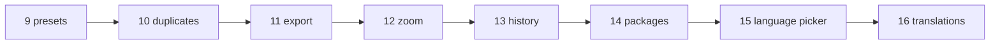

# DiskQuilt — feature roadmap (v1.1 → v1.4)

Source: `docs/REVIEW.md` "Missing features, ranked", minus everything already shipped, plus one
gap found while auditing `docs/PLAN.md` (4.5 was marked done but is absent from the code).

This plan covers only work that is **not** in the current build. The remediation plan in
`docs/PLAN.md` is closed; its remaining deferred item (3.4 memory compaction) was superseded by the
follow-up pass and needs nothing further.

## Constraints

Unchanged from `docs/PLAN.md`:

- Single `:app` module. No Hilt, no DataStore, no new runtime dependency unless a task says so.
- `minSdk 26`, `targetSdk 35`. Storage model (`MANAGE_EXTERNAL_STORAGE`, optional root) does not
  change.
- Core logic is plain Kotlin and JVM-testable; framework code stays in the UI/IO edge.
- Every new user-visible string goes into **every** shipped `values*/strings.xml`; `LocaleParityTest`
  (Phase 16) enforces it instead of review.
- No new permission. If a feature cannot work within the existing grant, it says so on screen
  instead of asking for more.

Baselines from the current build, to keep the new work honest:

| Metric | Value |
|---|---|
| Full volume scan | 127.9 K files / 940 dirs / 105.7 GB in ~59 s (TECNO LI7) |
| PSS after a full scan | 158 MB |
| Treemap cells per layout | capped at 3 000 |
| Unit tests | 54, all JVM |
| Strings | 119 keys x 2 locales (en, in) |

## Ordering and releases

| Cut | Phases | Theme |
|---|---|---|
| v1.1 | 9, 11 | Finish what the old plan promised; make results portable |
| v1.2 | 10 | The differentiator: reclaim space |
| v1.3 | 12, 13 | Comfort and trend |
| v1.4 | 14 | "Who owns my storage" |
| v1.5 | 15, 16 | Speak the user's language |

Phases 15–16 depend on nothing in 9–14 and can be pulled into any earlier cut.

Each phase is one commit-sized change set and ends with:

1. `:app:testDebugUnitTest` green (including the new tests below).
2. `:app:lintDebug` still 0 errors.
3. Debug APK installed on the TECNO LI7; the phase's user-visible change proven by a screenshot.
4. `:app:assembleRelease :app:bundleRelease` still build (CI proves this on every push).

Sizes: **S** ≤ half a day, **M** 1–2 days, **L** 3+ days (translation volume), tests included.

---

## Phase 9 — Quick presets (S) · v1.1

Planned as 4.5, never implemented. Restores the one-tap paths the review called table stakes.

| ID | Task | Files | Acceptance |
|---|---|---|---|
| 9.1 | `Presets.kt`: given the primary volume root, return the candidate set `{WhatsApp, Telegram, DCIM, Download}` with absolute paths. No Android imports | new `scan/Presets.kt` | JVM test asserts the exact path for each id |
| 9.2 | Resolve visibility with an injected predicate: a preset is shown only when the directory exists **and** can be listed. The Telegram data path is restricted on Android 11+, so it disappears instead of opening an empty scan | `scan/Presets.kt`, `ui/HomeScreen.kt` | With a fake predicate, missing/forbidden presets are omitted |
| 9.3 | Home: preset cards under the volume list, each starting a folder scan through `ScanTarget.folder(path)` with the preset label | `ui/HomeScreen.kt`, `ui/ScanTarget.kt` | One tap scans WhatsApp media; the result header names the preset |
| 9.4 | Strings (en + in) and a 48 dp touch target | `res/values/strings.xml`, `values-in/strings.xml` | TalkBack focus lands on a labelled card |

Tests: `PresetsTest` — path table, dedupe when a volume root differs, hidden when absent.

Risks: WhatsApp media lives under `Android/media/` (readable with all-files access); Telegram's
bulk data is under `Android/data/` (not readable on 11+ without root). The plan hides it rather than
pretending it can be scanned.

## Phase 10 — Duplicate finder (M) · v1.2

Never existed; ranked "differentiator" by every reviewer. Read-only and cancellable.

| ID | Task | Files | Acceptance |
|---|---|---|---|
| 10.1 | Candidate selection over `NodeStore`: regular files ≥ 1 MiB, not links, grouped by exact size; groups of one dropped | new `scan/Duplicates.kt` | Pure test over a hand-built store |
| 10.2 | Partial hash: first 64 KiB, SHA-256, 4 concurrent readers, cancel checked every file | `scan/Duplicates.kt` | Same-size/different-content files never survive this stage |
| 10.3 | Full hash for survivors only, 1 MiB buffer, cancel every 4 MiB; result groups sorted by reclaimable bytes (`size × (n−1)`) | `scan/Duplicates.kt` | Three 5 MB copies → one group, 10 MB reclaimable |
| 10.4 | In-memory hash cache keyed by `path + size + mtime`, cleared on a new scan | `scan/Duplicates.kt` | A second run on an unchanged tree hashes nothing |
| 10.5 | UI: action in the result header opens a Duplicates screen with progress, cancel, group list, expandable members, multi-select delete reusing `Deleter` | new `ui/DuplicatesScreen.kt`, `ui/ScanViewModel.kt`, `ui/ResultScreen.kt` | Cancel returns within 0.5 s; deleting one copy leaves the group consistent |
| 10.6 | Unreadable members are skipped and counted; the screen states "N files could not be read" | `scan/Duplicates.kt`, `ui/DuplicatesScreen.kt` | Restricted path does not crash the pass |

Tests: `DuplicatesTest` — size collisions, partial-hash collisions resolved by full hash, 0-byte
exclusion, cancellation, cache hits, reclaimable arithmetic.

Risks: hashing a large photo/video volume costs battery. The 1 MiB size floor and the two-stage hash
bound it; measure the pass duration on the LI7 and raise the floor to 5 MiB if it exceeds ~20 s.

Not in scope for v1: keeping "one copy per group" automatically, hardlink detection (FUSE shared
storage does not expose hardlinks), and persisting hashes across sessions.

## Phase 11 — Export / share report (S) · v1.1

| ID | Task | Files | Acceptance |
|---|---|---|---|
| 11.1 | `ReportWriter` (pure Kotlin): RFC 4180 CSV with a UTF-8 BOM, sections for totals, largest files, type breakdown, and duplicates when present | new `export/ReportWriter.kt` | File opens in a spreadsheet with correct columns |
| 11.2 | Quote/escape commas, quotes, CR/LF and leading `=`/`+`/`-` (spreadsheet formula injection); tests cover each | `export/ReportWriter.kt` | A file named `a,"b"\n=c.csv` survives a round trip |
| 11.3 | Write to `cacheDir/exports/report-<timestamp>.csv`; add `<cache-path name="exports" path="exports/"/>`; share with `ACTION_SEND` and offer `ACTION_CREATE_DOCUMENT` to save elsewhere | `ui/ResultScreen.kt`, `res/xml/file_paths.xml` | Share sheet opens; "Save as" persists outside the app |
| 11.4 | Rows capped (largest 1 000, types all) so a 128 K-file tree cannot produce a 20 MB file | `export/ReportWriter.kt` | Report stays under ~1 MB for the baseline scan |

Tests: `ReportWriterTest` — escaping, injection guard, totals reconciliation, row cap.

## Phase 12 — Treemap zoom and pan (M) · v1.3

Today the canvas has tap and double-tap only; the review called pinch-zoom a "nice-to-have" that
users expect from WinDirStat.

| ID | Task | Files | Acceptance |
|---|---|---|---|
| 12.1 | `TreemapTransform` (pure): scale 1..8, offset clamped so content never leaves the viewport, inverse point mapping | new `ui/TreemapTransform.kt` | Round-trip tests; clamping tests at the edges |
| 12.2 | Wire `detectTransformGestures` + double-tap reset into the canvas; reset on drill-down and tab switch | `ui/TreemapCanvas.kt` | Pinch and drag feel anchored to the finger |
| 12.3 | Hit-testing uses the inverse transform, so a tap drills into the cell under the finger at any zoom | `ui/TreemapCanvas.kt` | Tap after zoom opens the same node as pre-zoom |
| 12.4 | Labels computed from transformed rects; cells below the label threshold stay unlabelled; TalkBack nodes follow the transform | `ui/TreemapCanvas.kt` | No overlapping labels at 1×; spoken order matches visual order |
| 12.5 | A small "reset zoom" affordance appears only while zoomed | `ui/ResultScreen.kt` | Reset returns to exactly 1× / origin |

Tests: `TreemapTransformTest` — inverse mapping, clamp, zoom-at-point, hit-test equivalence.

## Phase 13 — Scan history and trend (M) · v1.3

`RecentScanStore` keeps one scan. Extend it to a bounded history without a new dependency.

| ID | Task | Files | Acceptance |
|---|---|---|---|
| 13.1 | `HistoryCodec` (pure): encode/decode a newline-delimited, escaped entry format; cap 20; drop corrupt lines individually | new `data/HistoryCodec.kt` | Corrupt line does not lose the rest |
| 13.2 | Store v2 writes a JSON-free list; migrate the existing single-record keys on first read | `data/RecentScanStore.kt` | Upgrading an installed build keeps the last scan |
| 13.3 | Home "Recent scans" list (3 rows + "See all"): label, size, relative time, delta vs the previous scan of the same path | `ui/HomeScreen.kt` | Delta reads `+2.1 GB` / `−400 MB`, never `NaN` |
| 13.4 | Trend detail: last 10 scans of one path as a simple bar strip (no chart dependency) | `ui/HomeScreen.kt` | Bars scale to the max value; empty history shows the empty state |

Tests: `HistoryCodecTest` — escaping, cap/eviction order, corrupt entries, migration, delta math
(including a first-ever scan and a zero-byte scan).

## Phase 14 — Per-package view (M) · v1.4

| ID | Task | Files | Acceptance |
|---|---|---|---|
| 14.1 | `PackageIndex` (pure): given `(package, dirs)` pairs and a scanned `NodeStore`, attribute bytes by longest-prefix match over `Android/data/<pkg>`, `Android/media/<pkg>`, `Android/obb/<pkg>`, and the APK itself | new `scan/PackageIndex.kt` | Sibling prefixes (`com.foo` vs `com.foo.bar`) never collide |
| 14.2 | Build the dir list from `PackageManager` on a background dispatcher; include APK sizes from `sourceDir` | `ui/ScanViewModel.kt` | APK bytes appear even when data dirs are unreadable |
| 14.3 | Types tab gains an "Apps" section: package label, icon, visible bytes, and a badge when `data`/`obb` were not readable | `ui/ResultScreen.kt` | WhatsApp row sums media bytes after a root deep scan |
| 14.4 | Explain partial coverage inline ("visible bytes only — Android/data and Android/obb need root") | `ui/ResultScreen.kt`, strings | No silent under-reporting |

Tests: `PackageIndexTest` — longest-prefix match, unknown paths unattributed, unreadable dirs marked,
empty package list.

Risks: `Android/data` and `Android/obb` are unreadable on Android 11+ without root, so most packages
will show partial numbers. That is a platform limit, not a bug; the UI must say so.

---

## Phase 15 — In-app language picker (M) · v1.5

**Current state: there is no language option.** The app follows the system locale and ships
`values/` (English) and `values-in/` (Indonesian), 119 strings each. `ui/Format.kt` formats numbers
and dates with `Locale.getDefault()`, and the manifest has no `localeConfig`, so Android 13's
per-app language screen shows nothing.

The picker must work back to API 26, so it does not rely on `LocaleManager` (API 33) and does not
add AppCompat just for `setApplicationLocales`. One dependency-free override point keeps the
behaviour identical on every version:

| ID | Task | Files | Acceptance |
|---|---|---|---|
| 15.1 | `LanguageStore`: persist one tag from `system,en,in,es,pt,fr,de,hi,ru,zh-Hans,zh-Hant,ko,ja`; unset or unknown tag reads as `system`; own `SharedPreferences` file so it survives "clear recent scans" | new `data/LanguageStore.kt` | JVM test: default, round-trip, unknown → system |
| 15.2 | `AppLocale.apply(base, tag)`: return `base.createConfigurationContext(config with locale)` and set `Locale.setDefault`; `system` returns `base` untouched | new `ui/AppLocale.kt` | JVM test asserts configuration locale and default locale for `es` and `system` |
| 15.3 | `MainActivity.attachBaseContext` applies the stored tag before Compose inflates; `Format.kt` keeps `Locale.getDefault()`, so decimal comma and translated dates need no call-site changes | `MainActivity.kt` | On `es`, `1.5 GB` renders `1,5 GB` |
| 15.4 | About dialog gains a **Language** row: radio list with "System default" plus each language **in its own name** (`English`, `Bahasa Indonesia`, `Español`, `Português`, `Français`, `Deutsch`, `हिन्दी`, `Русский`, `简体中文`, `繁體中文`, `한국어`, `日本語`); selecting persists and calls `recreate()` | `ui/HomeScreen.kt`, strings (en + in) | Selecting Español re-renders Home in Spanish without killing the app |
| 15.5 | `res/xml/locales_config.xml` + `android:localeConfig`; on API 33+ mirror an explicit choice into `LocaleManager.setApplicationLocales`, and clear it for `system` | `AndroidManifest.xml`, new `res/xml/locales_config.xml`, `MainActivity.kt` | Settings → Apps → DiskQuilt → Language lists the same thirteen entries (system + twelve languages) |
| 15.6 | Precedence documented: an explicit in-app choice wins; `system` defers to the OS per-app locale, then the device locale | `README.md`, `docs/TRANSLATIONS.md` | No way to end up with two contradicting selections |

Tests: `LanguageStoreTest` (valid/invalid tags, persistence), `AppLocaleTest` (config + default
locale, `system` is a no-op). Device check: pick each language, force-stop, relaunch, confirm it
stuck; start a scan, change language mid-scan, confirm progress and results survive the recreate
(the scan lives in the ViewModel).

Risks: `Locale.setDefault` is process-global — set it in `attachBaseContext` and again after a
change, never per-composable. Android 13's system picker and the in-app picker can disagree unless
15.5 mirrors the value; if mirroring fails on a vendor ROM, the in-app choice still governs.

## Phase 16 — Additional languages (L) · v1.5

Ten new locales at 119 strings each. Translations are drafted here but **not** claimed as reviewed
until a native speaker signs off; that distinction is recorded in the repo.

| ID | Task | Files | Acceptance |
|---|---|---|---|
| 16.1 | Add `values-es/`, `values-pt/`, `values-fr/`, `values-de/`, `values-hi/`, `values-ru/`, `values-b+zh+Hans/`, `values-b+zh+Hant/`, `values-ko/`, `values-ja/` with every key. Chinese uses script qualifiers (`b+zh+Hans`, `b+zh+Hant`, API 21+) rather than `zh-rCN`/`zh-rTW`, so Hong Kong, Macau and Taiwan devices resolve to Traditional; "modern Chinese" is the Simplified set | `app/src/main/res/values-*/strings.xml` | Parity test green; a `zh-Hant` device never shows Simplified glyphs |
| 16.2 | `LocaleParityTest` (JVM): parse every `values*/strings.xml`; assert identical key sets, no blank values, and each locale's CLDR plural *minimum* (`ru`: one/few/many/other; `en`/`in`/`hi`: one/other; `zh`/`ja`/`ko`: other only); fail listing the missing keys or quantities | new `app/src/test/.../LocaleParityTest.kt` | Removing one string or the Russian `few` form fails the build |
| 16.3 | `docs/TRANSLATIONS.md`: table of locale, translator, status (`draft` / `reviewed`), date, known issues | new `docs/TRANSLATIONS.md` | Status is honest; no `reviewed` without a name |
| 16.4 | Screenshot Home and Result in each language at 1.3× font scale; fix clipped tabs, chips and buttons | `docs/images/`, UI if needed | Five-tab row and sort chips fit in `de`, `hi`, `ru`; full-width CJK punctuation does not wrap mid-token in `ja`, `ko`, `zh-Hant` |
| 16.5 | Keep `pt` as Brazilian Portuguese; a `values-pt-rPT` file is a later, separate task | `values-pt/` | `pt-PT` devices fall back to `pt` without crashes |

Notes:

- `hi` and `ru` produce the longest strings; the tab row (`Treemap / Contents / Largest / Types /
  Find`) and the sort chips are the first places text clips. Shorten the translation rather than the
  layout, and keep the English key semantics.
- Plural forms are per language, not per key: Russian needs `one/few/many/other`,
  English/Indonesian/Hindi `one/other`, and Chinese/Japanese/Korean only `other`. The parity test
  enforces each locale's minimum set; requiring identical quantities everywhere would add
  meaningless forms and still miss a Russian `few`.
- CJK needs its own review pass: no spaces between words, full-width punctuation (`，。；`), taller
  line boxes, and no `one` plural. Traditional Chinese characters are wider than Simplified at the
  same font size, so check the tab row and sort chips in `zh-Hant` before the Latin languages.
- Arabic and Hebrew are deliberately **not** in this phase: `supportsRtl` is already true, but no RTL
  layout pass has been done and shipping a flipped UI untested is worse than English.
- Korean and Japanese borrow many Latin technical terms; keep `Android/data`, `su`, `APK` and unit
  suffixes untranslated rather than inventing local forms.

---

## Documentation debt closed by this plan

| Item | Fix |
|---|---|
| `docs/PLAN.md` Phase 4 status claims "done and verified" | Amended to name 4.5 as missing and point here |
| README has no forward-looking section | `## Roadmap` links this file |
| No record of translation quality | `docs/TRANSLATIONS.md` (Phase 16.3) separates draft from reviewed |
| Android 13 per-app language screen is empty | `localeConfig` added in Phase 15.5 |

## Out of scope

- Scheduled/background scans (needs WorkManager and a new permission story).
- Cloud backup of results, accounts, telemetry — the app remains network-free.
- Root deep-scan end-to-end verification: still needs a rooted device; the parser keeps its unit
  tests.
- Migrating off Gradle 8.11.1 / AGP 8.7.2. Tracked separately because it changes the dependency
  matrix, not the product.
- Arabic and Hebrew, until a real RTL layout pass exists (see Phase 16 notes).
- Automated translation services in the build: translations stay files, reviewed by people.
