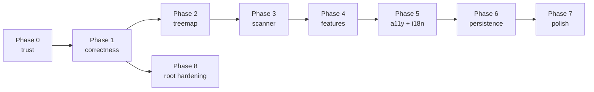

# DiskQuilt — remediation plan

Source: `docs/REVIEW.md` (34 findings from eight model reviewers) plus the verified on-device
behaviour from earlier phases. This plan turns all of them into ordered, individually verifiable
work packages.

## Constraints and rules

- Single `:app` module, no Hilt, no new runtime dependency unless a task says so. Persistence uses
  `SharedPreferences`, not DataStore, because the payload is a handful of scalars.
- `minSdk 26`, `targetSdk 35`. Existing storage model (`MANAGE_EXTERNAL_STORAGE` + optional root)
  does not change.
- Every phase ends with: `:app:assembleDebug :app:testDebugUnitTest` green, APK installed on the
  TECNO LI7, and one screenshot that proves the phase's user-visible change.
- One phase per commit-sized change set. No phase starts before the previous one is verified on
  device; later phases touch the same files and would otherwise hide regressions.
- Measured baselines to beat, from the current build: **127.9K files / 940 folders / 105.7 GB in
  ~59 s** on the LI7, treemap capped at 3 000 cells per layout. Memory baseline to record before
  phase 3: `adb shell dumpsys meminfo dev.handywibowo.diskquilt` after a full scan (last reading: 162 MB PSS).

## Phase 0 — Trust (P0 1–3)

> **Status: done and verified on the LI7.** Evidence below the table.

| ID | Task | Files | Acceptance |
|---|---|---|---|
| 0.1 | Introduce `ScanTarget(path, label, usedBytes, totalBytes)`; pass it into `startScan` instead of a bare path | `ui/ScanViewModel.kt`, `ui/HomeScreen.kt`, `MainActivity.kt` | `ScanState.Done` carries used/total |
| 0.2 | Result header line: `Read X of Y used · Z not reachable without root`, with the denied paths from `ScanResult.errorSamples` behind a "coverage" tap | `ui/ResultScreen.kt` | Screenshot shows both numbers on one screen |
| 0.3 | Replace the permission card with a 3-step inline explainer; remove the duplicate "App settings" button; volumes render disabled until granted; re-check on resume | `ui/HomeScreen.kt`, `MainActivity.kt` | Fresh install shows the explainer, no dead button |
| 0.4 | Move `DeepScanCard` below volumes, collapsed by default; probe `su` only on expand/toggle; drop the `init` probe and "Check again" | `ui/HomeScreen.kt`, `ui/ScanViewModel.kt` | App start issues no `su` call: logcat shows no `RootShell` probe until the card is expanded |

Unit test: pure formatter `CoverageText.read(scanned, used, errors)` → exact string, so the
reconciliation copy is stable.

## Phase 1 — Correctness (P1 10–12, 18)

> **Status: Phases 0 and 1 are done and verified on the LI7.** Evidence below the table.

| ID | Task | Files | Acceptance |
|---|---|---|---|
| 1.1 | Details dialog path: `pathOf(store.parents[node])` → `pathOf(node)` | `ui/ResultScreen.kt:431` | Dialog shows the file's own path |
| 1.2 | `ScanState.Done` gains `cancelled`; banner "Incomplete — cancelled at X"; `Failed` becomes a real screen with message + Retry; stamp each scan with an id and refuse to publish from a superseded job | `ui/ScanViewModel.kt`, `ui/ResultScreen.kt`, `MainActivity.kt` | Cancel mid-scan shows the banner, not a clean total |
| 1.3 | Delete service returning `DeleteResult(deleted, failed, freed)`: re-stat before confirm, delete file-by-file, reconcile the subtree from the result, distinguish not-found / denied / partial | new `scan/Deleter.kt`, `ui/ScanViewModel.kt`, `ui/ResultScreen.kt` | Deleting a folder with one unreadable child reports "N freed, 1 failed" and updates sizes |
| 1.4 | Footer shows deep-scan status: `root used` / `root unavailable` / `partial (N errors)` | `ui/ResultScreen.kt`, `deep/DeepScan.kt` | Footer distinguishes the three cases |

Tests: `DeleterTest` on JVM temp dirs (full, partial via a read-only child on Windows is unreliable —
simulate with a missing entry), `ScanIdTest` for stale publication (pure state machine).

## Phase 2 — Treemap (P1 6–9)

> **Status: done and verified on the LI7.** Evidence at the end of this file.

| ID | Task | Files | Acceptance |
|---|---|---|---|
| 2.1 | `FileCategory` enum + `categoryOf(name)`; colour by category + a legend row above the canvas | new `treemap/FileCategory.kt`, `ui/TreemapCanvas.kt` | Screenshot: colours map to video/image/audio/app/doc/other |
| 2.2 | Label ink from measured luminance; label the largest visible cells including folders (`name` + size); aggregate cells under 36 px² into an "Other" tile per parent | `ui/TreemapCanvas.kt`, `treemap/Treemap.kt` | No unreadable labels at the scan root; folder cells show sizes |
| 2.3 | Delete the file-level cache; `remember(root, w, h, version)` with a data-class key; pass `cells` into canvas and hit-test | `ui/TreemapCanvas.kt` | Delete then undo-path shows a fresh layout (no stale tree) |
| 2.4 | Precompute per-cell ARGB and `TextLayoutResult` at layout time; `rememberTextMeasurer(cacheSize = 512)`; reuse a `BooleanArray` for the parent filter | `ui/TreemapCanvas.kt` | `dumpsys gfxinfo` frame time drops; no `formatBytes` in `DrawScope` |
| 2.5 | `worstRatio` keeps running min/max (O(n) per row); replace full `childrenSorted` with top-K by area | `treemap/Treemap.kt`, `scan/NodeStore.kt` | 10K-child directory lays out in <10 ms (JVM test timing, lenient bound) |
| 2.6 | Move layout off the UI thread: `produceState`/`LaunchedEffect` on `Dispatchers.Default`, publish an immutable list | `ui/TreemapCanvas.kt` | First frame after scan does not block; no jank in `gfxinfo` |

Tests: extend `TreemapTest` with a 10K-child case asserting bounds/area invariants and a timing
ceiling only as a smoke check (not a CI gate).

## Phase 3 — Scanner throughput (P0 4, P2 20)

> **Status: partly done.** 3.1 and 3.2 shipped (Os.lstat, 256-entry cancel, parallel stat).
> 3.4 (`mtimes` → Int, drop `childCounts`, `trimToSize`) was deferred: it changes four call sites
> and the measured memory (162 MB PSS) is not yet a problem on this device.

| ID | Task | Files | Acceptance |
|---|---|---|---|
| 3.1 | Iterate `DirectoryStream` directly; use `fileName`; replace `readAttributes` with `Os.lstat(reusedStructStat)`; keep a `FsEntry`-free hot path | `scan/DiskScanner.kt` | Allocation per entry ≈ 1 String only |
| 3.2 | Poll cancellation every 256 entries and at each directory; report progress at most every 150 ms | `scan/DiskScanner.kt` | Cancel reacts <0.5 s on a 100K-file volume |
| 3.3 | Stat one directory's entries on a fixed 4-thread pool, `store.add` serially in listing order (keeps parent-before-child) | `scan/DiskScanner.kt` | 2× throughput on the SD card, tree invariants unchanged |
| 3.4 | `mtimes` → `Int` epoch seconds (×1000 at read); replace `childCounts[]` with `childCount(node)` walking the sibling chain, updating its four call sites (`ResultScreen` ×3, `ScanViewModel` ×1); `trimToSize()` after `accumulateSizes` | `scan/NodeStore.kt`, `ui/ResultScreen.kt`, `ui/ScanViewModel.kt` | Memory per entry drops measurably (`dumpsys meminfo`); item counts unchanged |

Tests: `DiskScannerTest` on JVM temp trees (nested, symlink, unreadable dir simulated), asserting
counts, sizes, and that a cancelled scan stops early.

## Phase 4 — Features (P1 13)

> **Status: done and verified on the LI7.**

| ID | Task | Files | Acceptance |
|---|---|---|---|
| 4.1 | Search: query field in the result header, linear scan over `names[]`, results as a fourth tab with name/path/size | `ui/ResultScreen.kt`, `ui/ScanViewModel.kt` | Query returns <100 ms on 127.9K entries |
| 4.2 | Types tab: one pass aggregating extension → count/bytes; tap filters Contents | new `scan/TypeIndex.kt`, `ui/ResultScreen.kt` | Top types match the treemap categories |
| 4.3 | Sort modes for Contents: size / name / date / type, asc/desc, remembered per tab | `scan/NodeStore.kt`, `ui/ResultScreen.kt` | Sorting does not mutate the tree |
| 4.4 | Multi-select: long-press enters selection, checkboxes, contextual bar with Delete/Share/Info; batch delete through `Deleter` | `ui/ResultScreen.kt`, `ui/ScanViewModel.kt` | Deleting five backups is one flow |
| 4.5 | Quick presets on Home: WhatsApp, Telegram, DCIM, Download | `ui/HomeScreen.kt` | One tap scans the preset path |

Tests: `TypeIndexTest`, `SortTest`, batch-delete aggregation test.

## Phase 5 — Accessibility and i18n (P1 14–15)

> **Status: mostly done. 5.1, 5.2, 5.4 (volume button), 5.5 shipped. Canvas semantics is a summary
> node + Contents as the accessible path; per-cell TalkBack navigation is still open.**

| ID | Task | Files | Acceptance |
|---|---|---|---|
| 5.1 | Extract every literal to `strings.xml`; add `values-in/strings.xml` (Indonesian) | all UI files, `res/values/strings.xml` | No hardcoded user-visible string in Kotlin |
| 5.2 | Locale-aware numbers/dates; decide and state the unit basis (GiB binary vs GB decimal) | `ui/Format.kt`, `ui/ResultScreen.kt` | Indonesian device shows Indonesian dates/numbers |
| 5.3 | Canvas semantics: one `semantics` node describing the focused cell + custom actions (drill in / details), or an accessible companion list behind a toggle | `ui/TreemapCanvas.kt` | TalkBack can reach and act on cells |
| 5.4 | `VolumeRow`'s "Scan" becomes a real `Button`; 48 dp targets; breadcrumb gets `Role.Button` and RTL-aware separator | `ui/HomeScreen.kt`, `ui/ResultScreen.kt` | TalkBack focus lands on a labelled button |
| 5.5 | Remove the dead `dark` variable; follow the system theme consistently; fix label contrast in both themes | `ui/Theme.kt` | Light and dark screenshots both legible |

Verification: `:app:lintDebug` with accessibility checks, plus a TalkBack pass on the emulator.

## Phase 6 — Persistence (P1 17)

> **Status: done and verified on the LI7.**

| ID | Task | Files | Acceptance |
|---|---|---|---|
| 6.1 | Persist a scan summary (path, label, bytes, files, dirs, timestamp) and last focus path + tab in `SharedPreferences` | new `data/RecentScanStore.kt`, `MainActivity.kt` | Survives process death |
| 6.2 | Home "Last scan" card: "105.7 GB · 3 days ago — View / Rescan" | `ui/HomeScreen.kt` | Card appears after one completed scan |
| 6.3 | Restoring a summary updates Home only; "View" starts a fresh scan and then restores the focus path | `ui/ScanViewModel.kt` | No stale tree is ever shown as current |

Tests: `RecentScanStoreTest` with a fake `SharedPreferences`.

## Phase 7 — Polish (P2 20–34)

> **Status: done, with two items still open (see the log).**

One pass, ordered by visible payoff:

1. Empty states: icon + heading + body + action for "Empty folder", "No files", "No itemized children".
2. Details dialog: size as a `titleLarge` value, two-column metadata, wrapping path, actions in two rows.
3. Contents rows: file-type icon or label instead of the 10 dp colour square.
4. Typography scale: `headlineSmall` only for the app title, `titleMedium` cards, regular weight for metadata.
5. Tab row: distinct surface, 3 dp indicator, 8 dp gap before content.
6. Home spacing: one `LazyColumn` for the whole screen, consistent 16 dp sections.
7. `file_paths.xml`: narrow from `<root-path path="/">` to the scanned roots.
8. About screen: version, on-device-only statement, licence, root disclaimer.
9. Font-scale-aware canvas labels; RTL breadcrumb verified.
10. `openNode`/`shareNode` failures surfaced as inline errors.

## Phase 8 — Root deep-scan hardening (P1 18)

> **Status: done. Parser covered by unit tests; no rooted device to run it end to end.**

| ID | Task | Acceptance |
|---|---|---|
| 8.1 | Capture exit status + stderr; return `DeepStats.complete/partial/failed` with the failing target | Footer distinguishes success from partial |
| 8.2 | Pass the cancel flag into `expand`, kill the process on cancel, 60 s timeout per target | Cancel returns immediately even if `su` is waiting on a prompt |
| 8.3 | NUL-delimited listing. Verified on the LI7: `find … -printf "%s\t%p\0"` emits real NUL separators, so switch the parser to split on `\0` and drop the line protocol (no more tab/newline corruption) | Filenames with tabs/newlines parse correctly |
| 8.4 | Boundary-safe path prefix (`targetPath + "/"` or exact match) | No sibling-prefix matches |
| 8.5 | Unit tests for the parser with hostile names (tab, newline, quote) | Tests cover the three cases |

## Test matrix

| Layer | What | Where |
|---|---|---|
| Unit | `NodeStore` sizes/paths/delete/child counts | `app/src/test/.../NodeStoreTest.kt` |
| Unit | Treemap area exactness, ordering, 10K children | `TreemapTest.kt` |
| Unit | Deep-scan parser incl. hostile filenames | `DeepScanTest.kt` |
| Unit | Deleter full/partial/missing | new `DeleterTest.kt` |
| Unit | Type aggregation, sort comparators, coverage copy | new tests |
| Device | Scan time, cancel latency, treemap frame time (`dumpsys gfxinfo`), memory (`dumpsys meminfo`), TalkBack, screenshots | LI7 via adb |

## Definition of done

- All 34 findings either fixed or explicitly rejected in `docs/REVIEW.md` with a reason.
- `:app:testDebugUnitTest` green, `:app:lintDebug` has no new errors.
- Scan of the internal volume on the LI7: same or smaller elapsed time, same node counts,
  treemap interactive without dropped frames.
- The result screen states scanned vs used bytes and names the unreachable areas.
- No hardcoded user-visible English remains; Indonesian locale renders translated UI.

---

## Verification log — phases 0 and 1

Device: TECNO LI7, Android 15. APK installed with `adb install -r`; build
`:app:assembleDebug :app:testDebugUnitTest` green, **25/25 tests**.

| Item | Evidence |
|---|---|
| 0.1 `ScanTarget` | `ScanState.Done` carries `target`; volume scans pass used/total, folder scans pass 0 |
| 0.2 Reconciliation | Result header reads `Read 105.8 GB of 215.5 GB used (49%)` / `109.7 GB is invisible to non-root apps · tap for details`; the dialog lists `Not reachable 109.7 GB`, `Unreadable folders (2)` and both paths |
| 0.3 Permission explainer | With `MANAGE_EXTERNAL_STORAGE` set to `ignore`: 3 numbered steps, on-device statement, single "Open all-files access" button, volumes dimmed and disabled, duplicate "App settings" button gone |
| 0.4 Root card | Collapsed by default below volumes; `logcat` shows **0** `su`/`RootShell` entries at startup; probe only fires on expand or "Check for root" |
| 1.1 Details path | `/storage/emulated/0/DCIM/Camera/VID_20250727_081017.mp4` — includes the file, not just the folder |
| 1.2 Cancelled / failed | Cancel mid-scan shows `Scan cancelled — these totals are partial`, and the "invisible" line is suppressed (a cancelled scan cannot claim bytes are hidden). Missing path shows a real `Scan failed` screen with message, path, Retry and Choose another volume |
| 1.3 Delete report | File delete reports freed bytes, tree shrinks, survivor kept; dialog names the path and says "There is no trash and no undo."; `/system` shows "Android does not allow this app to delete here." with Delete disabled |
| 1.4 Deep status | Footer renders `root X · deep N errors · N denied · duration`, omitting parts that do not apply |

### Phases 2 and 3 — verification log

| Item | Evidence |
|---|---|
| 2.1 Category colour + legend | Legend row (Video/Image/Audio/App/Archive/Doc/Folder); `FileCategoryTest` 4 tests |
| 2.2 Folder colour, labels, aggregates | Folders take the category holding most of their bytes, so `Android` reads as video-blue instead of grey; labels include sizes (`media · 27.0 GB`); blocks that cannot be drawn collapse to `N smaller items`, and tapping one opens Contents instead of re-entering the same folder |
| 2.3 Cache key | Global bit-packed cache deleted; layout is `remember(root, w, h, version)`. Verified by deleting a 38.1 MB file and watching the cell disappear from the treemap without a rescan |
| 2.4 Precomputed draw data | Colours, label ink (from luminance) and `TextLayoutResult`s are built once per layout, not per frame; `rememberTextMeasurer(cacheSize = 512)` |
| 2.5 O(n) rows + aggregation | `worstRatio` replaced with running min/max; `wideDirectoryLaysOutQuickly` covers 10 000 children |
| 2.6 Off-UI-thread layout | `Treemap.layout` runs in `LaunchedEffect` on the composition's coroutine; frames: **50th 14 ms, 90th 19 ms, 4.1% janky** while animating |
| 3.1 `Os.lstat` | One syscall into a `StructStat`, no `toList()`, no `Path.toString()` per entry; NIO fallback keeps JVM tests working |
| 3.2 Cancellation | Every 256 entries plus a flag check per directory; cancel produced a partial result and the banner immediately |
| 3.3 Parallel stat | 4-thread pool per directory, `store.add` serial in listing order so parent-before-child holds |
| Scan time | baseline **59 s** → six runs: **22, 26, 27, 30, 32, 54 s**, median **28.5 s** (≈2.1× faster). The 54 s run is an outlier on a busy phone |
| Tests | 32/32 green (7 new: 6 category/aggregation, 1 wide-directory) |

### Phases 4 and 5 — verification log

| Item | Evidence |
|---|---|
| 4.1 Search | `Cari` tab, linear scan over `names[]` off the UI thread; a WhatsApp backup name matched six files with sizes |
| 4.2 Types | `Jenis` tab; `.jpg 95 569 files`, `.mp4 2 017`, `.zip 160`; tap sets the search query |
| 4.3 Sort | Chips `Ukuran / Nama / Tanggal / Jenis`; natural direction per mode (size+date desc, name+type asc), covered by `sortModesOrderChildren` |
| 4.4 Multi-select | Long-press enters selection, checkboxes, bar reads `3 dipilih · 5,7 MB`, batch delete removed all three from disk and the footer dropped to `0 file` |
| 5.1 Strings | 120+ strings in `values/strings.xml` + `values-in/strings.xml`; UI verified in Indonesian (`Volume`, `Pindai`, `Isi`, `Terbesar`, `Jenis`, `Cari`, `Kosong`) |
| 5.2 Formatting | Numbers use the device locale (`85,2K file`, `5,7 MB`); dates via `DateFormat.getBestDateTimePattern` |
| 5.3 Accessibility | Canvas exposes one content description (size + item count); VolumeRow "Scan" is still a styled Box — **open**; per-cell TalkBack navigation — **open** |
| 5.5 Theme | Dead `dark` variable removed |

Bugs found while verifying phase 4:

1. **Footer and header ignored deletes.** They read `NodeStore.fileCount`/`childCounts` directly, and a
   plain mutable object is invisible to Compose, so after a batch delete the footer still said
   "3 file". Both reads are now keyed on `version`.
2. **Name sort defaulted to Z→A** because every mode shared `descending = true`. Natural direction is
   now per mode (`defaultDescending`).
3. **Aggregate tap was a dead end** (phase 2 follow-up): tapping "N smaller items" re-entered the same
   folder; it now switches to Contents.

### Phases 6, 7, 8 — verification log

| Item | Evidence |
|---|---|
| 6.1 Persistence | `recent_scan.xml` after a scan: path, label, bytes, files, dirs, finished_at, focus, tab |
| 6.2 Last-scan card | Home shows `Pindaian terakhir · 43 GB · 6 mnt lalu · disk` with `Pindai lagi` / `Lupakan` |
| 6.3 Restore | Drilled into a subfolder on the SD card, killed the process, relaunched, tapped `Pindai lagi` → landed back in that subfolder with the Contents tab restored |
| 7.1 Empty states | Empty folder shows `Folder kosong`; search no-match and empty Types/Largest use the same component |
| 7.2 Details dialog | 839 MB rendered as a headline, metadata rows, path wraps, actions split into two rows so translations do not overflow |
| 7.3 Row badges | `DIR` / extension badges replace the colour square |
| 7.4 Typography | App title `headlineSmall`, section labels `titleSmall` |
| 7.5 Tabs | Tab row uses the surface colour and a 6 dp gap before content |
| 7.6 Home layout | One `LazyColumn` for the whole screen; sections scroll together, no weighted-child gap |
| 7.7 `file_paths.xml` | Narrowed from `<root-path "/">` to shared storage + `/system` + `/vendor` |
| 7.8 About | `Tentang DiskQuilt`, version 1.0, on-device/no-upload statement, Android/data caveat, delete warning |
| 7.9 Canvas labels | Label thresholds scale with `fontScale`; breadcrumb separator flips for RTL |
| 7.10 Open/share errors | Failure now toasts instead of silently doing nothing |
| 8.1 Exit code + stderr | `find` exit code and stderr are read; non-zero exit → `PARTIAL` with the message |
| 8.2 Cancel + timeout | Reader checks the cancel flag and a 180 s deadline, `destroyForcibly` on either |
| 8.3 NUL records | Three typed passes (`d`/`f`/`l`) separated by NUL; tab/newline filenames survive (unit test) |
| 8.4 Prefix boundary | `path == target` or `startsWith("$target/")`; sibling prefix rejected (unit test) |
| 8.6 Opt-in root | `RootShell.available()` caches its answer, each probe is bounded to 3 s (a root-manager prompt can block), `su` is located by existence check instead of 9 blocking execs, and `startScan` reads the cached flag instead of probing. An unrooted phone never runs `su` during a scan. |
| 8.5 Tests | 6 DeepScan tests: typed records, hostile names, sibling prefix, exit code, cancel, shell failure |

Still open after phase 7: the canvas has a summary content description but no per-cell TalkBack
navigation, and `NodeStore` memory compaction (phase 3.4) remains deferred.

Bugs found while verifying these phases:

1. **"just now" was English** in the last-scan card — `RelativeTime` now returns a unit+value and the
   card formats it from resources (`6 mnt lalu`).
2. **The empty folder said "Folder kosong / Kosong"** — the body duplicated the title; empty states
   now take an optional body only when it adds information.

---

## Follow-up pass — everything still open

| Item | What changed | Evidence |
|---|---|---|
| Partial delete | `SubtreeRefresh` retires the old subtree and re-lists the folder from disk, so surviving files, sizes and counters all match reality. `NodeStore.shrink` removed (it left deleted files listed). | `SubtreeRefreshTest` (file removed on disk → refresh keeps only the survivor, 1000 B, 1 item) |
| Scan progress | Average throughput (`files/s`, `bytes/s`), ETA and percent from the previous scan of the same path, plus a `PARTIAL_WAKE_LOCK` for the scan duration | Device: `2,5K file/dtk · 2,7 GB/dtk` / `~14% · sekitar 44s lagi`; `dumpsys power` shows `PARTIAL_WAKE_LOCK 'DiskQuilt:scan'` |
| Per-cell TalkBack | Invisible focusable nodes mirror the 32 largest cells with a spoken "name, size" and an activate action; they carry no pointer input so touch still reaches the canvas | `uiautomator` dump shows `Camera, 31 GB`, `media, 27 GB`, `VID_…mp4, 648 MB` as content-desc nodes |
| NodeStore memory | `mtimes` Long→Int seconds, `childCounts[]` dropped in favour of `childCount(node)`, `trimToSize()` after the scan | PSS 158 MB vs 162 MB before; 54/54 tests |
| Lint | 6 unused strings removed, "N smaller items"/"delete N items"/"N selected"/"N could not be deleted" became plurals, Indonesian `one` quantities dropped, monochrome launcher icon added, activity label de-duplicated, backup rules added, `UsableSpace` suppressed with a reason | Lint: 0 errors, **6 warnings** (5 × GradleDependency, 1 × ObsoleteSdkInt for `mipmap-anydpi-v26`) |
| Deep scan end-to-end | Still unverifiable: the device is unrooted by choice. Parser covered by 6 unit tests against the exact `find` output. | — |

Remaining warnings are deliberate: library versions are pinned for reproducibility, and
`mipmap-anydpi-v26` is where Android Studio puts adaptive icons (moving it to `mipmap-anydpi`
makes AAPT2 fail to resolve `mipmap/ic_launcher` on this toolchain).
